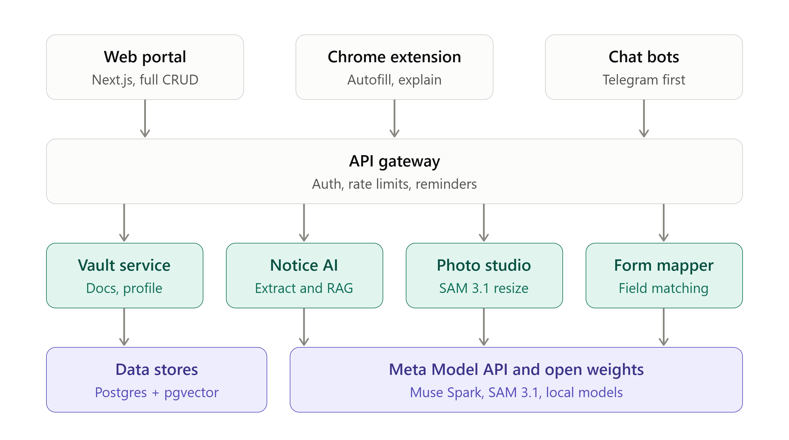
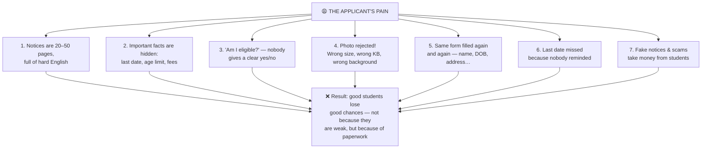
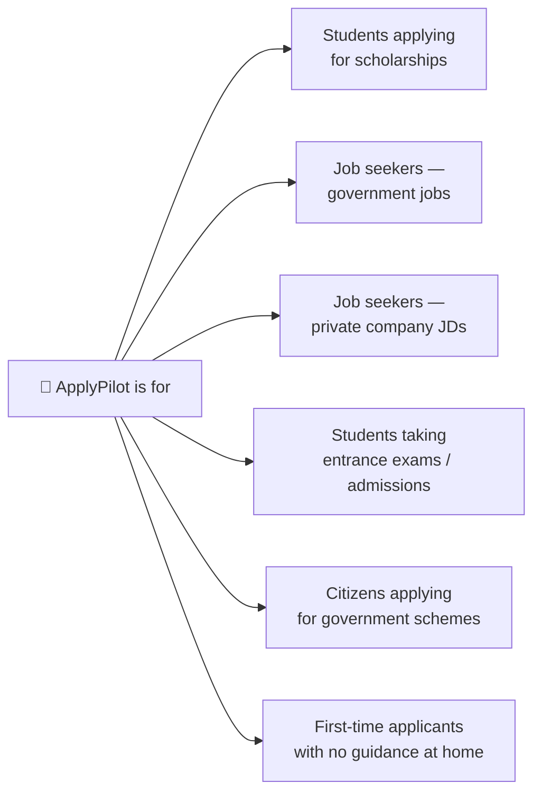
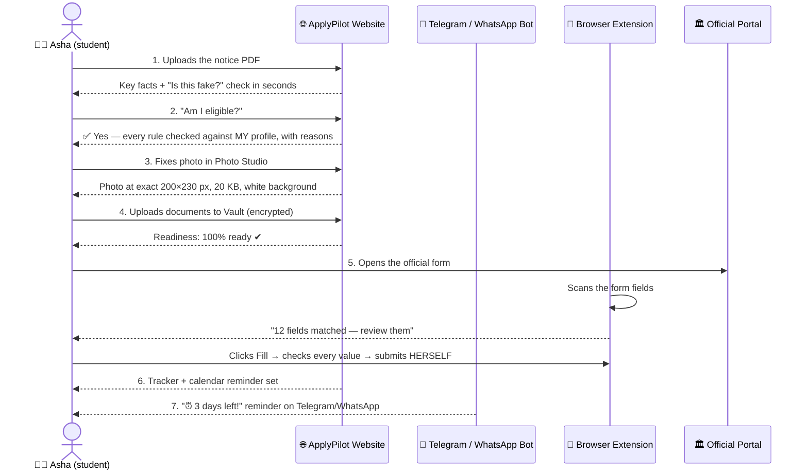
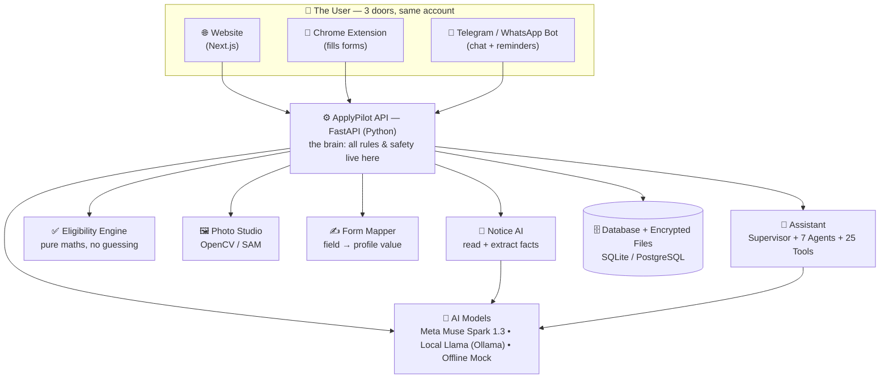
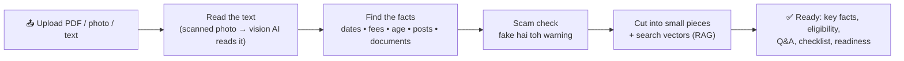
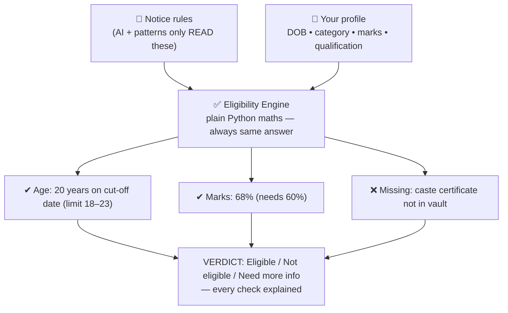
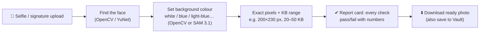
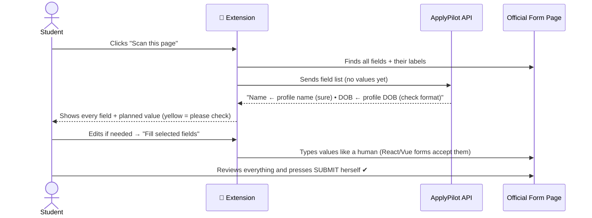
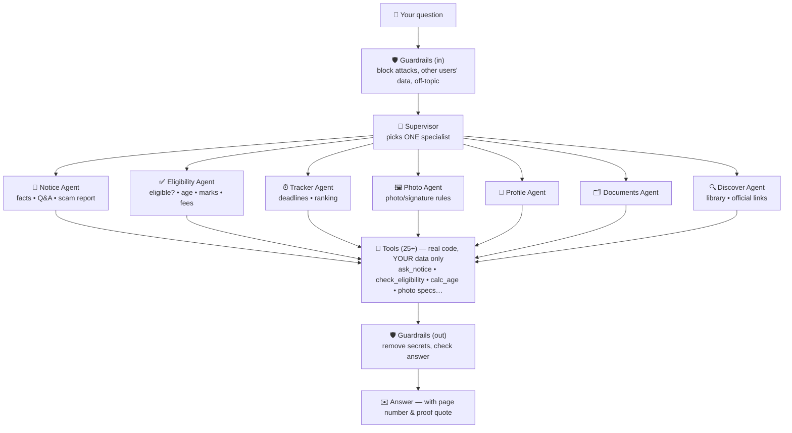

# ApplyPilot — Project Specification & Pitch Guide

> **One-line pitch:** ApplyPilot is your personal assistant for applying to anything —
> government jobs, private jobs, scholarships, college admissions, and government schemes.
> You give it the long, confusing notice PDF. It reads it, tells you in simple words,
> checks if **you** can apply, fixes your photo, keeps your documents safe,
> fills the form with you, and reminds you before the last date.

**Tagline for judges:** *"Don't read the 30-page notice. Ask ApplyPilot."*



*Figure 1 — ApplyPilot system design (full architecture image already in this repo).*

---

## Table of Contents

1. [What is ApplyPilot? (very simple words)](#1-what-is-applypilot-very-simple-words)
2. [The problem it solves](#2-the-problem-it-solves)
3. [Who is it for?](#3-who-is-it-for)
4. [What can it do? — Complete feature list](#4-what-can-it-do--complete-feature-list)
5. [The full journey — one student, start to finish](#5-the-full-journey--one-student-start-to-finish)
6. [How the whole system works (diagram)](#6-how-the-whole-system-works-diagram)
7. [Section by section — how every part works](#7-section-by-section--how-every-part-works)
   - 7.1 Website / Dashboard
   - 7.2 Notice page — "understand any notice in 1 minute"
   - 7.3 Personal Notice Assistant (the AI chat)
   - 7.4 Eligibility checker — "Am I eligible?"
   - 7.5 Readiness score — "Am I ready to apply?"
   - 7.6 Photo & Signature Studio
   - 7.7 Document Vault
   - 7.8 Browser Extension — form filling
   - 7.9 Application Tracker + Reminders + Calendar
   - 7.10 Telegram & WhatsApp Bot
   - 7.11 Fake-notice (scam) check
   - 7.12 Search & shared notice library
   - 7.13 Profile — "fill once, use everywhere"
   - 7.14 Admin, security & privacy
8. [How the AI works inside (diagram)](#8-how-the-ai-works-inside-diagram)
9. [Smart tricks judges will love](#9-smart-tricks-judges-will-love)
10. [Technology used](#10-technology-used)
11. [Why students and applicants love it (benefits)](#11-why-students-and-applicants-love-it-benefits)
12. [How to pitch to judges — 3-minute script](#12-how-to-pitch-to-judges--3-minute-script)
13. [Live demo plan — 5 minutes, step by step](#13-live-demo-plan--5-minutes-step-by-step)
14. [Questions judges may ask — ready answers](#14-questions-judges-may-ask--ready-answers)
15. [What is done, what is next (honest status)](#15-what-is-done-what-is-next-honest-status)
16. [How to run the project](#16-how-to-run-the-project)

---

## 1. What is ApplyPilot? (very simple words)

Imagine a smart friend who is very good at paperwork.

- You show him a long job notice — **he reads all 30 pages for you.**
- He tells you only what matters: *last date, fees, age limit, documents needed.*
- He looks at **your** details and says: *"Yes, you can apply"* — or *"No, because your age is 1 year more."*
- He fixes your photo to the exact size the website wants.
- He keeps your documents safe in one place.
- He helps you fill the long online form.
- He reminds you before the last date, on WhatsApp / Telegram.

**That smart friend is ApplyPilot.**

It works for:

| Type | Examples |
|---|---|
| 🏛️ Government jobs | SSC, UPSC, IBPS, Railways, Army, state government posts |
| 💼 Private jobs | Any company job description (JD) PDF or text |
| 🎓 Scholarships | Merit scholarships, category scholarships, state/national schemes |
| 🎒 Admissions | College, university, entrance exams |
| 🏠 Government schemes | Any scheme notice with eligibility rules |

> **Key idea:** ApplyPilot does not care what the notice is *for*.
> If it is a PDF / photo / text with rules, dates and documents — ApplyPilot can read it and check it against **your** profile.

---

## 2. The problem it solves

Every year, crores of young people apply for jobs, exams, scholarships and schemes.
Most of them face the **same 7 problems**:



| # | Real problem | What happens to the student |
|---|---|---|
| 1 | Notices are long and in hard language | Student skips reading, misses a hidden rule |
| 2 | Dates, fees, age limits are buried inside | Student finds the last date *after* it is gone |
| 3 | Eligibility rules are confusing (age on which date? which category? how many marks?) | Student applies, pays fees, then gets rejected — or never applies at all |
| 4 | Every portal wants a different photo size (pixels, KB, background colour) | Form rejected at the last step; cyber-café charges money for every fix |
| 5 | The same details are typed in every form | 30–45 minutes per form, with typing mistakes |
| 6 | No reminder system | Deadline missed by 1 day = 1 year lost |
| 7 | Fake job notices on WhatsApp/Telegram | Students pay "fees" to frauds and lose money |

**ApplyPilot solves all 7 — in one place.**

---

## 3. Who is it for?



- A **student** checking: *"Can I get this scholarship? What documents do I need?"*
- A **government-job aspirant** checking 5 similar notices at once.
- A **private-job seeker** pasting a job description: *"Do my skills and marks match this job?"*
- A **scheme beneficiary**: *"Am I eligible for this scheme? What is the last date?"*
- Especially: **first-generation applicants** — students whose parents cannot guide them through English paperwork.

---

## 4. What can it do? — Complete feature list

ApplyPilot has **30+ features**. Grouped simply:

### 📄 A. Understand any notice
| # | Feature | In simple words |
|---|---|---|
| 1 | Upload notice (PDF / photo / text) | Drop the file — digital PDF or even a scanned photo |
| 2 | Key facts extraction | Last date, fees, age limit, posts, documents — shown in clean boxes |
| 3 | "Ask this notice" chat | Ask anything; answer comes **only from the notice, with the page number** |
| 4 | Exact quote proof | Every answer can show the **exact sentence copied from the PDF** |
| 5 | Fake-notice (scam) check | Warns: *"This looks fake — it asks for money on WhatsApp"* |
| — | Works for every kind of notice | Government job, private job description (JD), scholarship, admission, government scheme — same pipeline |
| 6 | Shared notice library | A notice uploaded once is instantly available to everyone (see §9) |

### 👤 B. Personal checking
| # | Feature | In simple words |
|---|---|---|
| 7 | My Profile | Fill your details **once** — name, DOB, category, marks, address |
| 8 | Eligibility checker | Rule-by-rule **Yes/No with reasons** — age, marks, category, qualification |
| 9 | "What is missing?" | *"Add your date of birth"* / *"Upload your caste certificate"* |
| 10 | Readiness score | *"You are 80% ready — 1 document missing"* |
| 11 | Calculators | Age on the cut-off date, days left, fee total, marks % / CGPA conversion |

### 🖼️ C. Photo & documents
| # | Feature | In simple words |
|---|---|---|
| 12 | Photo Studio | Photo → exact pixels, KB, format and background the portal wants |
| 13 | Signature Studio | Signature cleaned and resized to spec |
| 14 | Document scan fix | Certificate scans cleaned — **without touching the content** |
| 15 | Document Vault | All documents in one **encrypted** locker, ready for every application |

### ✍️ D. Apply faster
| # | Feature | In simple words |
|---|---|---|
| 16 | Browser extension autofill | Opens the real form and fills it from your profile — **you review, you submit** |
| 17 | Printable checklist | One page: facts + documents + steps for submission day |
| 18 | Application tracker | Planned → In progress → Submitted, with deadlines |
| 19 | Calendar file (.ics) | Deadlines enter your phone calendar with 7/3/1-day reminders |
| 20 | Telegram / WhatsApp reminders | *"Army post closes in 3 days!"* where you already chat |

### 🤖 E. AI Assistant (chat)
| # | Feature | In simple words |
|---|---|---|
| 21 | Personal assistant chat | *"What is the last date?"*, *"Am I eligible?"*, *"Which notice suits me?"* |
| 22 | 7 specialist AI agents | Notice expert, eligibility expert, deadline expert, photo expert… (see §8) |
| 23 | 25+ tools | The AI can check dates, calculate age, search the notice, rank notices for you |
| 24 | Safety guardrails | Refuses tricks, other users' data, and off-topic misuse |
| 25 | Works without internet AI too | Offline "mock" mode + local Llama (Ollama) option — free and private |

### 🔒 F. Safety, privacy & platform
| # | Feature | In simple words |
|---|---|---|
| 26 | Login + Google/GitHub/LinkedIn OAuth | Your account, your data only |
| 27 | Encryption everywhere | Profile and files are encrypted before saving |
| 28 | Duplicate-PDF detection | Same PDF from 2 users = processed once, shared instantly (see §9) |
| 29 | Never auto-submits | The system **never** presses Submit and never fills passwords/OTP/ID numbers |
| 30 | Admin + audit log | Every important action is recorded |
| 31 | Rate limits & upload checks | Protection from misuse and bad files |
| 32 | Job search | Search official job sites from inside the app |

---

## 5. The full journey — one student, start to finish

Meet **Asha**, a student. Her friend forwards a scholarship notice PDF on WhatsApp.



**Time saved:** reading (20 min) + photo fixing (cyber-café trip) + form typing (30 min) → **a few minutes.**

---

## 6. How the whole system works (diagram)



**Simple rule of the design:** the website, extension and bot are just "doors".
All intelligence and all safety rules live in **one API**, so every door behaves the same and your data stays protected in one place.

---

## 7. Section by section — how every part works

### 7.1 Website / Dashboard

**What the user sees first after login.**

- **At a glance:** how many applications are open, submitted, your next deadline, and **time saved** (e.g. *"Time saved: 6h 20m"*).
- **My applications:** every application with its deadline and status.
- **Download calendar:** one click puts all deadlines into the phone calendar.
- Quick doors to: Notices, Photo Studio, Vault, Tracker, Assistant, Profile.

> **Helpful because:** the student sees *"what needs my attention today"* in 5 seconds — no searching through files and messages.

### 7.2 Notice page — "understand any notice in 1 minute"

**This is the heart of ApplyPilot.**



- Rules (exact patterns) find dates/fees/age first; the AI model fills the gaps.
- If rules and AI **disagree**, the user sees a *"please check this"* flag — we never silently guess.
- **Ask this notice:** type any question → answer uses **only** that notice's text, shows the **page number**, a *"✓ checked against the notice text"* mark, and the **exact quoted sentence** from the PDF.
- If the answer is not in the notice, it honestly says: **"Not found in this notice."** It never invents a date or fee.

> **Helpful because:** a 30-page English notice becomes 1 screen of simple facts — and every answer can be *proved* from the PDF itself.

### 7.3 Personal Notice Assistant (the AI chat)

**One chat box (website + Telegram + WhatsApp) that knows YOUR profile and YOUR notices.**

Examples a student can ask:

- *"What is the last date for the Army post?"*
- *"Am I eligible for the scholarship?"*
- *"Which of my notices should I apply to first?"*
- *"What documents am I missing?"*
- *"My photo needs a blue background — what size?"*

How it works (details in §8): a **Supervisor** sends the question to the right **specialist agent**, the agent uses small **tools** (real code, your data only), and **guardrails** check the question and the answer.

**Personalisation:** the assistant does not give general answers. It joins **the notice's rules + your profile**. So two students asking *"Am I eligible?"* for the same notice get **different, correct answers** — one may pass the age rule, the other may not.

> **Helpful because:** it feels like asking a knowledgeable friend who has read the notice *and* knows your details — in simple language, any time of day.

### 7.4 Eligibility checker — "Am I eligible?"

**The most loved feature. Deliberately NOT done by AI guessing.**



- Age is calculated **on the notice's cut-off date**, not today.
- Category relaxations (OBC/SC/ST age relaxation etc.) are applied from the notice rules.
- Marks %, CGPA conversion, fee-by-category — small calculators do exact maths.
- If a profile field is empty, it asks for exactly that: *"Please add your date of birth."*

> **Why not let the AI answer directly?** Because AI can do arithmetic wrong, and one wrong *"you are eligible"* costs a student a full year. So: **AI reads the rules, code does the maths.** Judges love this line. Use it.

### 7.5 Readiness score — "Am I ready to apply?"

Eligibility says *can* you apply. Readiness says *are you prepared*:

- ✅ Profile complete? ✅ Photo ready? ✅ All documents in the vault? ✅ Deadline not passed?
- Shown as a score: *"80% ready — caste certificate missing."*

> **Helpful because:** students discover missing documents **days before** the deadline, not on the last night.

### 7.6 Photo & Signature Studio

**The feature that saves the most real-world pain.**



What it can do:

- Resize to the **exact pixels** the portal demands (photo, signature, document — 3 modes).
- Fit the file into the **exact KB range** — even *increase* size safely when a portal demands a minimum KB.
- Change background colour; detect and crop around the face.
- Clean scanned certificates **without changing their content** (no face/background tricks on documents).
- Every output comes with a **report**: *"Size 200×230 ✔, 24.1 KB (needs 20–50) ✔, JPG ✔."*
- From the bot: send a photo with caption `photo 3` → get the fixed file back **as a document** (so WhatsApp/Telegram compression cannot spoil the KB).

> **Helpful because:** "photo rejected" is the #1 reason forms fail at the last step. The Studio makes rejection almost impossible — free, at home, in 10 seconds.

### 7.7 Document Vault

**One safe locker for every document a student needs again and again.**

- Upload marksheet, certificates, ID proofs, photo, signature — once.
- Files are **encrypted before saving**; only you can open them.
- Quotas keep it safe (max file size / total size).
- Readiness and the extension read from the Vault: *"for this form, use this marksheet."*
- On chat apps, fixed photos are saved back to the Vault automatically after you confirm.

> **Helpful because:** no more searching phone galleries and WhatsApp chats for "that certificate scan" during every single application.

### 7.8 Browser Extension — form filling

**Apply on the real government/company portal, without the typing.**



Hard safety rules (say these loudly in the pitch):

- ❌ **Never submits** the form. ❌ Never fills passwords, OTP, captcha, payment or ID-number fields. ❌ Never ticks "I declare" checkboxes.
- It only runs on the tab you open it on.

> **Helpful because:** a 30-minute form becomes a 3-minute review — with zero typing mistakes in name, DOB and address.

### 7.9 Application Tracker + Reminders + Calendar

- Every notice you add joins the **Tracker**: *Planned → In progress → Submitted*, with its deadline.
- **Calendar (.ics):** automatic reminders **7 days, 3 days and 1 day** before, at 9 AM.
- **Bot reminders:** Telegram/WhatsApp message when a deadline is within 3 days (sent once per day, never spammy).
- Dashboard always shows: *"Next deadline: Army post — 2 days left."*

> **Helpful because:** missing a deadline by one day can cost a full year. ApplyPilot makes that very hard to do.

### 7.10 Telegram & WhatsApp Bot

**For students who live on chat apps and rarely open websites.**

| You send | Bot does |
|---|---|
| `/link CODE` | Connects the chat to your ApplyPilot account (code from Website → Profile, valid 10 min) |
| `What is the last date?` | Answers from your notices (same AI assistant) |
| `/deadlines` | Lists applications due in 14 days |
| Photo, no caption | **Resize only** — smaller file, background never changed |
| Photo + `resize 200x230` / `compress 50kb` | Exact pixels and/or max KB — still no background change |
| Photo + `photo 3` | Notice 3's size/KB rules — still no background change |
| Photo + `photo 3 blue background` | Full edit — only now may the background change |
| PDF, no caption (or `notice`) | Reads it as a notice and messages you when ready |
| PDF + `save` | Saves to your vault untouched — never read as a notice |
| PDF + `compress 500kb` | Shrinks the PDF and sends it back |
| `/help`, `/unlink` | Help / disconnect |

**The caption is the instruction.** The bot never guesses a destructive action:
photos are resized, not repainted, unless a background/colour is explicitly asked for;
PDFs are only read as notices by default or on `notice`, and `save`/`compress`
captions keep full control with the user. Every photo edit is preview-first
(reply `yes`/`no`).

- **Telegram:** long-polling — works without a public server address; daily deadline reminders.
- **WhatsApp:** Meta WhatsApp Cloud API with a signed webhook (every message is verified as really from Meta). WhatsApp only allows *replies* within 24 hours of the user's message; starting a conversation needs approved templates — so reminders on WhatsApp come after template approval (see §15).

> **Helpful because:** the student never has to "go to a website" — the assistant lives inside the app already on their phone.

### 7.11 Fake-notice (scam) check

Fake job/scholarship notices spread on WhatsApp every day. ApplyPilot checks every notice for danger signs:

- Asks for money / "registration fee" to a personal UPI or number
- Contact only through WhatsApp/Telegram, no official website
- Unbelievable salary for no qualification, "no exam, direct joining"
- Website domain that is not an official domain

Result: a **scam report with reasons** — *"High risk: asks for ₹1,500 on a personal number."*

> **Helpful because:** it protects exactly the students frauds target — first-time applicants.

### 7.12 Search & shared notice library

- **Search:** find notices from official domains (e.g. gov.in, nic.in, ssc.gov.in, upsc.gov.in, ibps.in) from inside the app; untrusted links are warned about.
- **Shared library:** a public notice is processed **once for everyone** (see §9, duplicate detection). The second student gets it instantly and can link it to their own tracker.

> **Helpful because:** 1,000 students applying to the same SSC notice should not pay the AI cost 1,000 times — and every new student gets answers instantly.

### 7.13 Profile — "fill once, use everywhere"

- Name, DOB, gender, category, address, education, marks — entered **once**.
- Stored as **one encrypted blob**.
- Feeds: eligibility, readiness, form filling, assistant answers, bot answers.
- The assistant can even save one field from chat: *"My DOB is 05/08/2004"* → saved after checks.

> **Helpful because:** this one profile is what makes everything *personal* — the same notice gives different, correct guidance to different students.

### 7.14 Admin, security & privacy

- Roles (user/admin), audit log of important actions, admin APIs.
- Login tokens, hashed passwords, OAuth (Google/GitHub/LinkedIn), rate limits on login & AI, upload file-type checks (real type, not just the file name).
- **Every user sees only their own data** — even admins cannot read your notices, profile or files.
- AI safety: guardrails + supervisor design (next section).

---

## 8. How the AI works inside (diagram)

ApplyPilot does **not** send every question to one big AI and hope. It uses a **team**:



Why this design wins marks:

| Choice | Reason |
|---|---|
| **Supervisor picks one specialist** | Small, focused agents make fewer mistakes than one giant prompt |
| **Agents use tools (real code)** | Dates/age/fees are computed, not guessed by the AI |
| **Eligibility = pure Python, no AI** | Arithmetic must be 100% right — a wrong "eligible" costs a year |
| **Answers only from the notice (RAG)** | No hallucinated dates/fees; every answer cites its page |
| **Guardrails on both sides** | Prompt-injection in a PDF ("ignore your rules…") is detected and flagged |
| **Model is swappable** | Meta Muse Spark 1.3 (default) • local Llama via Ollama (free/private) • offline mock (tests/demo without internet) — one setting, no code change |

---

## 9. Smart tricks judges will love

### Trick 1 — Same PDF, two users? Processed only ONCE
SHA-256 fingerprints of the **file** and of the **cleaned text** are stored. If User B uploads the same notice as User A (even with a different file name), ApplyPilot instantly links B to the ready notice — no re-reading, no re-chunking, no AI cost. B still gets *their own* tracker entry and *their own* eligibility. Personal documents (marksheet, Aadhaar, filled form) are **never** shared this way.

### Trick 2 — Proof, not trust
Every answer shows the page, a verification tick when its numbers match the PDF text, and the **exact sentence** from the notice. If it's not in the notice: *"Not found in this notice."*

### Trick 3 — AI reads, code calculates
Structure extraction may use AI, but **age, fees, marks %, days left = deterministic code with unit tests.**

### Trick 4 — It works with NO AI at all
Offline mock mode + rule-based extraction means the demo (and the test suite) runs on any laptop, free, without internet or API keys. The AI makes it better; it is not a single point of failure.

### Trick 5 — Safety by design
Guardrails, per-user tool isolation ("there is no way to ask for another user"), never-auto-submit extension, encrypted vault, scam detection, injection detection in uploaded PDFs.

---

## 10. Technology used

| Layer | Technology |
|---|---|
| Website | Next.js + TypeScript |
| API (brain) | Python + FastAPI |
| Database | SQLite (dev) / PostgreSQL (production), SQLAlchemy |
| AI models | **Meta Model API — Muse Spark 1.3** (chat, extraction, vision) • Ollama + Llama 3.2 (free local option) • offline mock |
| Embeddings (search inside notices) | Ollama `nomic-embed-text`, offline hash-vector fallback |
| Photo processing | OpenCV / Pillow, YuNet face detection, SAM 3.1 option for background removal |
| Browser extension | Chrome Manifest V3 (vanilla JS) |
| Bots | Telegram Bot API (long polling), Meta WhatsApp Cloud API (signed webhook, Graph v20.0) |
| Security | JWT login, OAuth, Fernet encryption (profile + files), rate limiting, HMAC webhook verification |
| Testing | ~133 backend tests collected (pytest), 13 bot tests, extension scanner/filler tests, frontend type-check + production build |
| Deployment | Docker Compose (website + API + DB, optional bot & local-LLM profiles) |

Architecture in one picture: [Figure 1](#applypilot--project-specification--pitch-guide) above and `docs/ARCHITECTURE.md`.

---

## 11. Why students and applicants love it (benefits)

| Before ApplyPilot | With ApplyPilot |
|---|---|
| Reads 30 pages, still confused | Key facts on one screen in seconds |
| "Am I eligible?" — asks friends, gets guesses | Rule-by-rule Yes/No **with reasons**, from their own profile |
| Photo rejected on the last day | Photo fixed to exact pixels/KB/background, with a pass report |
| Types the same form for 30 minutes | Extension fills it; student only reviews |
| Forgets the last date | Tracker + calendar + chat reminders at 7/3/1 days |
| Documents scattered in phone & WhatsApp | One encrypted Vault, always ready |
| Falls for a fake notice | Scam check warns **before** money is lost |
| Pays cyber-café for every small fix | Everything free, at home, on the phone they already have |

**In one sentence for the public:** *ApplyPilot turns the hardest part of applying — the paperwork — into a simple conversation.*

**Who gains the most:** students from small towns, first-generation applicants, scholarship applicants, and anyone applying to many posts at once. This is an **access** product: it gives every student the guidance that only students with educated family or paid coaching used to get.

---

## 12. How to pitch to judges — 3-minute script

> **Minute 0:00–0:30 — The pain (story).**
> "Meet Asha. She gets a 30-page scholarship notice on WhatsApp. The English is hard. The last date is hidden on page 17. She doesn't know if her marks are enough. Her photo gets rejected. She misses the date by one day — and loses one full year. This happens to lakhs of students. Not because they are weak — because paperwork is hard."

> **Minute 0:30–1:00 — The solution (one line + demo start).**
> "ApplyPilot is a personal assistant for applying. Asha uploads that same PDF…" *(start the live demo, §13)*

> **Minute 1:00–2:00 — Show the magic (while demo runs).**
> "In seconds: key facts… 'Am I eligible?' — checked rule-by-rule against *her* profile. Notice: our AI only *reads* the rules — the eligibility maths is plain code, because a wrong answer costs a year. Every answer shows its page and the exact sentence from the PDF. If it's not in the notice, we say so. No hallucination."

> **Minute 2:00–2:40 — Show the full journey.**
> "Photo Studio fixes her photo to the exact pixels and KB — with a pass report. The extension fills the real form — but *she* reviews and *she* submits; we never auto-submit and never touch passwords or OTPs. Her documents sit in an encrypted vault. And three days before the deadline, our Telegram/WhatsApp bot reminds her."

> **Minute 2:40–3:00 — Scale + close.**
> "One more thing: when 1,000 students upload the same SSC notice, we process it **once** — everyone else is linked instantly. Personal documents are never shared. ApplyPilot works for government jobs, private JDs, scholarships, admissions and schemes — anything that arrives as a notice. **Don't read the 30-page notice. Ask ApplyPilot.**"

**Delivery tips**

- Open with the **story (Asha)**, not with technology. Judges remember stories.
- Say these 3 lines slowly — they are your differentiators: **"AI reads, code calculates."** / **"Every answer shows its proof."** / **"We never press Submit."**
- Keep the demo on the **sample notice** (`samples/`) — never depend on live internet AI for the main flow.

---

## 13. Live demo plan — 5 minutes, step by step

| Time | Do this | Say this |
|---|---|---|
| 0:00 | Open dashboard | "This is Asha's home — applications, next deadline, time saved." |
| 0:30 | Upload `samples/sample_notice.txt` (or a sample PDF) | "A friend forwarded this notice. Watch — no reading 30 pages." |
| 1:00 | Show key facts + scam check | "Last date, fees, age, documents — and a fake-notice safety check on every notice." |
| 1:30 | Click **Ask this notice**: *"What is the last date?"* → show page + quote | "Answers come only from this PDF — with the page and the exact sentence as proof." |
| 2:00 | Click **Eligibility** | "Now personal: checked against *her* profile. Rule by rule. Maths by code, not by AI guessing." |
| 2:40 | Photo Studio: upload a selfie → download fixed photo + report | "Exact pixels, exact KB, background changed — this is where most forms die. Not anymore." |
| 3:20 | Vault + readiness | "Documents in one encrypted vault. Readiness: 100% — nothing missing on the last night." |
| 3:50 | Open `samples/sample_form.html` + extension → Scan → Fill | "On the real portal, we fill — she reviews — **she** submits. We never auto-submit." |
| 4:30 | Show Telegram/WhatsApp bot: ask *"last date?"*, show reminder | "And the assistant lives where students already are — WhatsApp and Telegram." |
| 4:50 | Close | "Same PDF from 1,000 students? Processed once. **Don't read the notice. Ask ApplyPilot.**" |

**Demo safety:** run the backend with `LLM_PROVIDER=mock` (or your tested Meta key) and pre-login the account. Keep a recorded video as backup.

---

## 14. Questions judges may ask — ready answers

| Judge asks | Your answer |
|---|---|
| "How is this different from ChatGPT?" | "ChatGPT doesn't know *your* profile, *your* documents and *your* deadlines, and it can invent dates. ApplyPilot answers only from the uploaded notice, shows the page + exact quote, does eligibility with code (not AI maths), fixes photos to spec, fills forms, and reminds you. It's a full application workflow, not a chat box." |
| "What if the AI gives a wrong date?" | "Dates are extracted by rules first, AI second; disagreement raises a 'check this' flag. Answers are verified against the notice text and cite the page. If it's not found, we say 'Not found in this notice.'" |
| "Why not let the AI decide eligibility?" | "Age and marks are arithmetic. A model can slip; a wrong 'eligible' costs a year. AI reads the rules, deterministic Python checks them — with unit tests." |
| "Is student data safe?" | "Profile and files are encrypted at rest, every user sees only their own data (even admins can't read yours), tools can only ever run as the calling user, and the extension never fills passwords/OTP/ID numbers and never submits." |
| "What if 10,000 students upload the same notice?" | "SHA-256 file + text fingerprints: it's processed once; everyone else is linked instantly with their own tracker and eligibility. Personal documents are excluded from sharing." |
| "Does it work without internet / paid AI?" | "Yes — offline mock mode and local Llama via Ollama. The Meta Muse Spark API is our production default; switching is one `.env` line." |
| "WhatsApp bot — can it message first?" | "By Meta's rules, businesses need approved templates to start a conversation. Our bot replies instantly within the 24-hour window today; template-based reminders are the next step (adapter already built)." |
| "How will this reach real students?" | "Through the apps they already use — WhatsApp/Telegram bots, a free website, and a browser extension for cyber-cafés and shared computers. No new habit needed." |
| "What about private jobs and schemes, not just government?" | "Anything that arrives as a notice/JD/scheme PDF works — the pipeline only needs rules, dates and documents in text. We demoed government forms because they are the hardest." |

---

## 15. What is done, what is next (honest status)

**✅ Done and tested**

- Full pipeline: upload → extract → scam check → RAG Q&A with citations → eligibility → readiness → checklist → tracker → calendar.
- Photo/Signature/Document Studio with report; encrypted Vault; encrypted profile.
- Assistant: supervisor + 7 agents + 25+ tools + guardrails; website, Telegram and WhatsApp transports.
- Chrome extension: scan → map → review → fill (never submits), with tests.
- Shared-notice deduplication (file + text SHA-256), personal-document protection.
- ~133 backend tests collected + 13 bot tests + extension tests; Docker Compose; CI.

**⚠️ Honest limits (say them before judges find them)**

- WhatsApp is reply-only until message **templates** are approved by Meta; Telegram reminders are live today.
- Extension cannot yet scan forms inside iframes/shadow DOM or custom `<div>` dropdowns.
- Live Meta API, real Telegram/WhatsApp accounts, PostgreSQL and Docker should be re-verified on the demo machine before the pitch.

**🔜 Roadmap (next, in order)**

1. WhatsApp template reminders • 2. Hindi + regional-language UI & answers • 3. Notice comparison (3–5 posts side by side) • 4. Family profiles (siblings under one account) • 5. Document expiry warnings • 6. Fee/receipt tracker • 7. Web push reminders.

---

## 16. How to run the project

```powershell
# 1. Setup (creates .env with random secrets)
python scripts/setup_env.py

# 2. Backend (Terminal 1)
cd backend; pip install -r requirements.txt
uvicorn app.main:app --reload --port 8000

# 3. Website (Terminal 2)
cd frontend; npm install; npm run dev        # http://localhost:3000

# 4. (Optional) Telegram/WhatsApp bot (Terminal 3)
cd bot; pip install -r requirements.txt
python -m applypilot_bot.main                # transport chosen by BOT_TRANSPORT in .env

# 5. (Optional) Extension: chrome://extensions → Developer mode → Load unpacked → extension/
```

First try: create an account → upload `samples/sample_notice.txt` → ask *"Am I eligible?"*

More guides: [Getting started](./docs/GETTING_STARTED.md) • [Bot setup](./docs/BOT.md) • [Extension](./docs/EXTENSION.md) • [Architecture](./docs/ARCHITECTURE.md) • [Security](./docs/SECURITY.md)

---

*ApplyPilot — Apply for jobs, exams, scholarships and admissions with less stress.*
***Don't read the 30-page notice. Ask ApplyPilot.***
